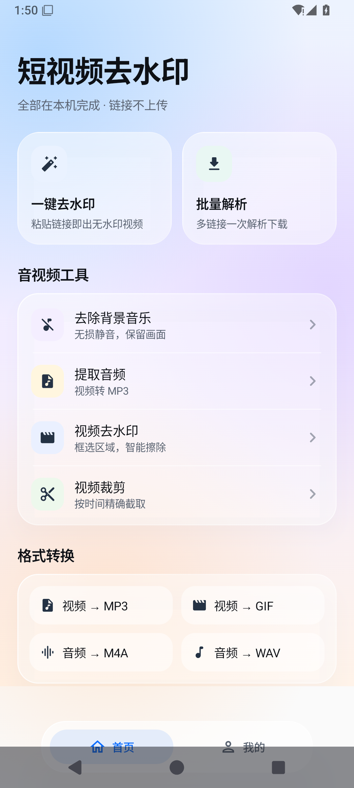

# 短视频去水印

ShortVideo Cleaner · 一个完全在手机本地运行的短视频去水印工具。

粘贴作品链接就能解析抖音、快手、小红书、B 站的视频与图文；不登录、不上传链接、不经过任何服务端。

## 特性

- 本地解析：链接与解析结果只在设备内处理，不会离开手机
- 抖音 / 快手 / 小红书 / B 站
- 视频无水印直链、图文多图下载
- 图文可逐张勾选，只保存想要的那几张
- 视频裁剪、去除背景音乐、提取音频
- 格式转换：视频 → MP3 / GIF，音频 → M4A / WAV
- 批量解析：一次粘贴多条链接
- 液态玻璃界面，浅色通透

## 截图

| 首页 | 解析 | 我的 |
| --- | --- | --- |
|  |  |  |

## 构建

需要 JDK 17、Android SDK 35。

```bash
cd android
./gradlew assembleDebug
```

产物：`android/app/build/outputs/apk/debug/app-debug.apk`

## 结构

```
android/            Android 客户端（Kotlin + Jetpack Compose）
  app/src/main/java/com/orange/nowatermark/
    parser/         四平台解析与 WebView 抓取
    ui/             页面与液态玻璃组件
    media/          ffmpeg 封装与媒体处理
docs/screens/       截图
```

## 说明

- 解析依赖各平台公开分享页，页面结构变化时可能需要更新适配
- 请只下载自己有权保存的内容，尊重原作者与平台规则

## 作者

FaithRain
